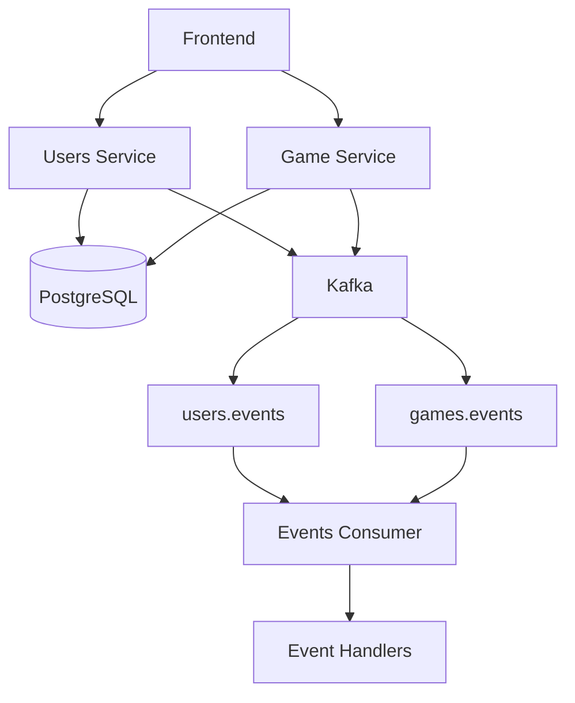

# Mini Chess

Mini Chess es una aplicación de ajedrez basada en microservicios backend independientes desarrollados en Go. Utiliza gRPC para comunicación interna, PostgreSQL para persistencia y Apache Kafka para mensajería asíncrona.

---

## 1. Arquitectura del proyecto

El sistema desacopla sus componentes principales para procesar movimientos y eventos sin bloquear el flujo principal:

* **Frontend:** Interfaz de usuario.
* **Users Service:** Registro, autenticación (JWT/bcrypt) y gestión de usuarios.
* **Game Service:** Administración de partidas, validación de reglas y movimientos.
* **Events Consumer:** Procesamiento asíncrono de eventos recibidos vía Kafka.
* **PostgreSQL & Apache Kafka:** Base de datos relacional y broker de eventos.

### Diagrama de arquitectura



---

## 2. Tecnologías utilizadas

| Tecnología | Función |
| --- | --- |
| Go | Desarrollo backend |
| gRPC / Protocol Buffers | Comunicación interna y contratos API |
| PostgreSQL | Persistencia de datos |
| Apache Kafka / kafka-go | Mensajería asíncrona entre servicios |
| Docker & Compose | Contenerización y orquestación |
| JWT / bcrypt | Seguridad y autenticación |

---

## 3. Estructura del proyecto

```text
New Mini Chess/
├── docker-compose.yml
├── .env
├── proto/
│   ├── user.proto
│   └── game.proto
├── services/
│   ├── users-service/    (main.go, kafka.go)
│   ├── game-service/     (main.go, kafka.go)
│   └── events-consumer/  (main.go, consumer.go, handlers.go)
└── db/
    ├── 01_schema.sql
    └── 02_init_data.sql

```

---

## 4. Servicios backend

### Users Service

Gestiona registro, login y autenticación. Al registrar un usuario, publica el evento `user.registered` en el tópico `users.events`.

### Game Service

Administra partidas, estado del tablero, capturas y validación de reglas bajo transacciones PostgreSQL. Publica eventos como `game.move_completed` y `game.reset` en `games.events`.

### Events Consumer

Microservicio en Go encargado de procesar los eventos de Kafka de forma asíncrona mediante grupos de consumo (`users-events-group` y `games-events-group`).

---

## 5. Eventos y Mensajería (Kafka)

### Tópicos

* `users.events`: Eventos de cuenta (`user.registered`).
* `games.events`: Eventos del tablero (`game.move_completed`, `game.reset`).

### Estructura de eventos (Ejemplo)

```json
{
  "event_id": "unique-event-id",
  "event_type": "game.move_completed",
  "game_id": 1,
  "details": "piece_id=68,from=C2,to=C3",
  "created_at": "2026-10-30T10:40:00Z"
}

```

---

## 6. Despliegue y Ejecución

Entorno orquestado mediante Docker Compose:

```cmd
# Construir e iniciar el sistema
docker compose up -d --build

# Verificar estado y logs
docker compose ps
docker compose logs -f events-consumer

```
